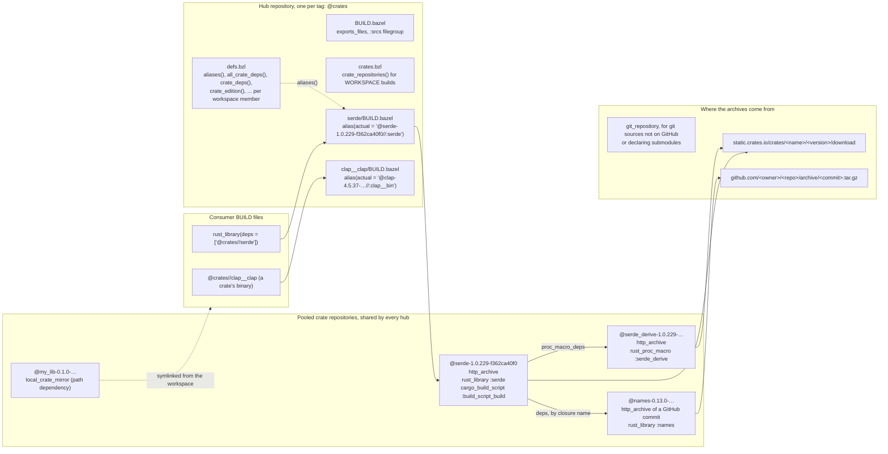

# What crate_universe renders

`crate_universe` turns a Cargo resolution into Bazel repositories. This page
describes the repositories the `crate` module extension declares for a build and
how they refer to each other, so that a change to the renderer can be checked
against the intended shape. The diagram is maintained by hand; when a template
or the extension changes what is rendered, update it in the same change.

## Hubs and pooled crate repositories

Every `crate.from_cargo` or `crate.from_specs` tag declares one **hub**, a
repository whose files only point at crates. The crates themselves live in
repositories **pooled** across every hub of the build: a crate's repository is
named after the crate and the hash of its *closure*, everything that shapes its
BUILD file, so two hubs that resolved the same `serde` with the same features and
dependencies share one repository and compile it once. See `src/pool.rs` for the
closure and `cargo-bazel pool` for the rendering.

### The hub

| File | Contents |
| --- | --- |
| `BUILD.bazel` | `exports_files` for the module files and a `:srcs` filegroup. No targets of its own: `@hub//:name` does not exist, `@hub//name` does. |
| `defs.bzl` | The dependency helpers, `aliases()`, `all_crate_deps()`, `crate_deps()`, `crate_edition()` and friends, keyed by the workspace member calling them. |
| `crates.bzl` | `crate_repositories()`, which declares the spokes for WORKSPACE builds. Under bzlmod the extension declares them directly and this file is informational. |
| `<crate>/BUILD.bazel` | One subpackage per crate a workspace member depends on, holding a single `alias` to the crate's library target in its pooled repository. `alias_rule` annotations change the rule used. |
| `<crate>__<bin>/BUILD.bazel` | One subpackage per binary of a crate with `gen_binaries`, aliasing the `rust_binary`. |

### A pooled crate repository

Named `<name>-<version>-<closure>`. Its `BUILD.bazel` is rendered from the
crate's resolved context under a hub independent configuration, so equal closures
render identically whichever hub produced them; `pool` fails if two hubs disagree,
which means the closure hash is missing an input. It holds:

- `rust_library` or `rust_proc_macro` for the library target, with
  `crate_features`, `deps` and `proc_macro_deps` pointing at other pooled
  repositories by their closure names, split by platform with `select()` on the
  platform labels the root module configured;
- `cargo_build_script` and the `build_script_build` target when the crate has a
  build script, plus the `links` dependencies it needs;
- `rust_binary` targets when binaries are requested;
- `cargo_toml_env_vars` when enabled, so `CARGO_PKG_*` match the manifest.

The repository rule is chosen by the crate's source: `http_archive` for registry
crates and for git dependencies hosted on GitHub, which are fetched as the archive
of their pinned commit with a checksum; `git_repository` for other git sources
and for repositories declaring submodules; `local_crate_mirror` for path
dependencies, which copies the workspace directory and adds the rendered BUILD
file.

## Other entry points

`crates_repository` (WORKSPACE) and `crates_vendor` render the same hub files
but their own spokes, named `<hub>__<name>-<version>`, since there is no module
extension to pool across. Local vendoring (`crates_vendor(mode = "local")`)
writes the crates' sources and BUILD files into the workspace instead of
declaring repositories.
